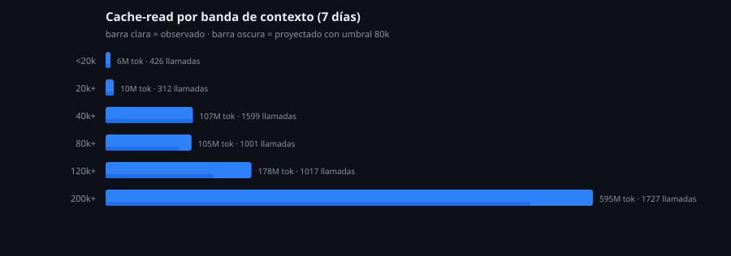

# Optimización de costo en un agente LLM: medir antes de optimizar

Bitácora y herramientas de un trabajo de reducción de costo sobre un agente que corre en producción (Hermes + `deepseek-v4.1-flash` vía OpenCode Go). Cuatro etapas, cada una cerrada con evidencia cruda: **estabilidad → contexto → delegación → eficiencia**.

No es un tutorial de configuración. Es el registro de qué se midió, qué se cambió y qué se demostró falso por el camino.



## El punto de partida

En 7 días de operación real: **6,321 llamadas**, 1,019 M de tokens leídos de caché, 54.5 M de input fresco, 7.34 M de output. Contexto por llamada: media **146 k**, p50 93.6 k, p95 381 k. Costo semanal medido: **$25–26** sobre un techo de $30.

Con esos números el problema dejó de ser "gastamos mucho" y pasó a ser "¿en qué se va?".

## Qué se cambió y qué se proyectó

| Clave | Antes | Después |
|---|---|---|
| `compression.threshold_tokens` | 120,000 | **80,000** |
| `compression.protect_last_n` | 20 | **16** |

Dos claves. Nada de modelo, routing ni delegación.

Proyección sobre el histórico (modelo: el contexto por encima de 80 k baja 40 k, suelo 80 k): **cache-read −13.7 %**, unos −137 M tokens por semana.

**Y el resultado incómodo, que está en el documento de cierre:** el gasto *no* baja. Comprimir más a menudo rompe la caché más a menudo, así que el input fresco sube y compensa. Estimado: **+$1.4 a +$2.7 por semana**. La métrica que mejora es la latencia y el tamaño de contexto, no la factura. Eso se escribe en el reporte en lugar de esconderse.

## El hallazgo que nadie esperaba

La intuición decía que el agujero eran las esperas: 36 filas de telemetría marcadas como `WAIT_LONG_COMMAND`. Al auditar la señal contra el código:

- eran **26 episodios reales**, no 36;
- **13 de 54 llamadas (24 %) no eran esperas**: 8 eran `write_file`/`patch` cuyo *contenido* menciona `sleep` o `timeout` — escribir un vigilante no es esperar — y 5 eran guardas `timeout 12/15`.

Costo real de las esperas: 28 rondas, **28 minutos** de bucle bloqueado, 2.10 M tokens. Real, medible y **no era el problema**.

El problema era otro: **la ronda de más.** Un solo día acumuló 867 llamadas y 68.5 M tokens de input; una sesión se llevó **32.6 M = 47 % del día**, con **110,863 tokens de input por llamada**. Ahí cada ronda extra cuesta 1.5× que en el resto.

Y debajo, tres patrones repetidos:

- **196 de 762 llamadas (26 %)** repiten la misma firma dentro del mismo turno; 55 relecturas del mismo archivo.
- **50 de 148 rondas (34 %)** ocurren *después* del último cambio real del turno — ≈3.7 M tokens de cierre tardío.
- **150 resultados > 8 kB** reinyectados ronda tras ronda; dos de 51 k y 40 k caracteres viajaron entre 45 y 65 rondas después: **0.4–0.65 M tokens cada uno**.

## Método

- Todo sale de fuentes de solo lectura: `model_usage.jsonl`, `state.db` (abierto con `mode=ro`), logs del supervisor. **Ningún análisis pasa por un LLM**: si la medición la hace el mismo sistema que se mide, la medición no vale.
- Precios explícitos (peak / off-peak) en el propio script, no "tarifa promedio" inventada.
- Cada etapa cierra con un `.md` que incluye el diff mínimo aplicado, el hash de la configuración antes y después, backup para rollback y la orden exacta para revertir.
- Las etapas se validan en un entorno con `HERMES_HOME` propio: la suite E2E prueba el *script* de aplicación (marcador presente, configuración derivada, doble ejecución idempotente), no la configuración viva.

## Estado

| Etapa | Estado |
|---|---|
| 01 · Estabilidad | Cerrada |
| 02 · Reducción de contexto | **Aplicada y validada** |
| 03 · Delegación | Cerrada |
| 04 · Eficiencia | Análisis y diseño terminados; parche **preparado, no activado** |

Trabajo en curso. La etapa 04 es la más honesta del repositorio: mide el desperdicio antes de tocar nada, y su conclusión es que tres de las medidas recomendadas **no requieren código** (nada de `sleep`-probe ni polling; una lectura por fichero por turno) y que la única línea de código necesaria es la que corrige el detector para que la métrica no mienta.

## Reproducir

```bash
python3 analysis/stage1_compcost.py        # costo real por pasada de compresión
python3 analysis/stage1_analysis.py        # bandas de contexto y distribución
python3 analysis/stage1_money.py           # reparto de gasto 7 días con precios peak/off
python3 analysis/make_chart.py             # regenera el gráfico desde la evidencia
```

`evidence/` conserva la salida cruda tal como se generó: métricas de 7 días, bandas y costo, verificación previa y la suite de la puerta E2E.

## Sobre el código

Los scripts de medición se publican para que el método sea reproducible y verificable. La documentación es de exhibición.

© 2026 Javier Cuevas. Todos los derechos reservados. Disponible bajo licencia por contacto.
